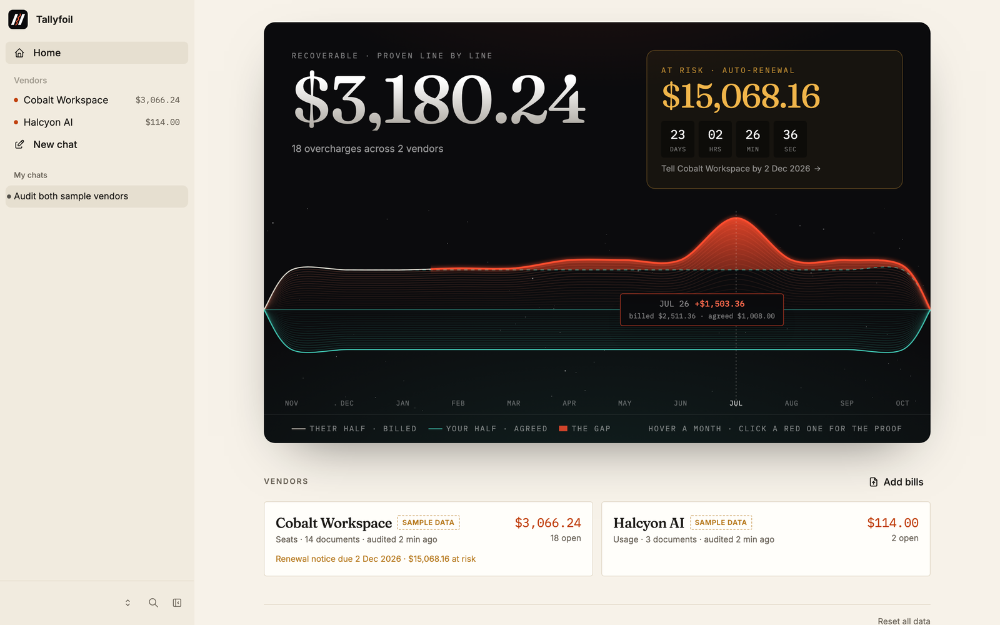
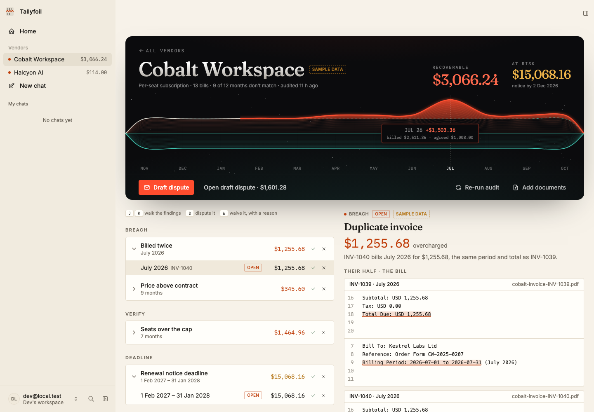
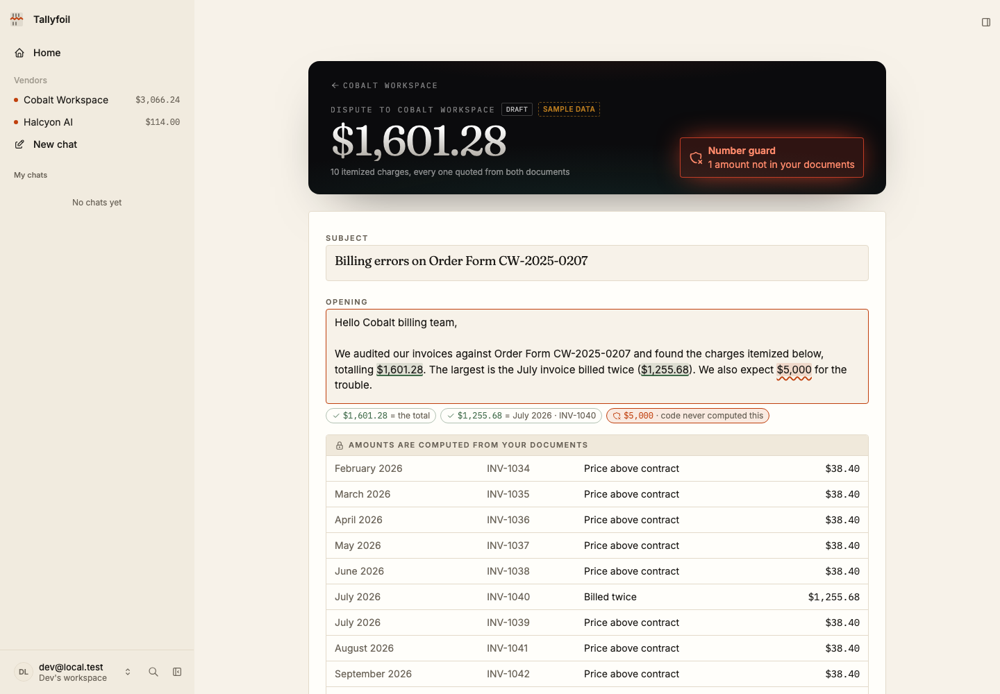
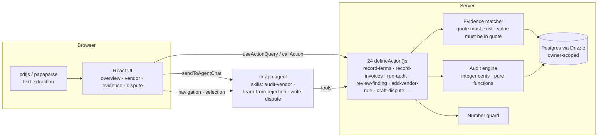

# Tallyfoil

**Tallyfoil finds what your vendors overcharged you, proves it, and drafts the email to get it back.**

The AI reads; code decides the money.



Upload a vendor's contract and invoices, plus the usage export for AI/API vendors. The
in-app agent reads every document and records each term and bill line. Each value has to
come with an exact quote, and the app checks that quote against the source text before
saving it. A deterministic audit engine, not the model, then computes every finding:

| Check | Severity |
|---|---|
| Invoice billed twice for the same period | breach |
| Unit price above the contract (renewal uplift cap) | breach |
| Usage billed above what the usage export logged | breach |
| Metered rate above contract | breach |
| Seats billed beyond the licensed cap | verify |
| Auto-renewal notice deadline approaching | deadline |

The table maps the engine's checks to the severity it gives each one.

## What you can do

- **See the gap.** The mirror chart puts what they billed above the line and what you
  agreed below it. An honest month is symmetric. An overcharge breaks the mirror, and
  you can click it to open the proof.
- **Click any number.** Every amount opens two halves: the bill line and the contract
  clause, both highlighted in the original document, with the arithmetic between them.
- **Triage fast.** <kbd>J</kbd>/<kbd>K</kbd> step through findings while the evidence
  follows. <kbd>D</kbd> stamps a finding for the dispute; <kbd>W</kbd> waives it and asks
  why.
- **Teach it, with proof.** Reject a finding with a reason ("we approved 48 seats by
  email") and paste the email. The agent turns the reason into a vendor rule and quotes
  the approval line as proof, then the audit re-runs. Rules are labeled *Proven by email*
  or *Your word*.
- **Dispute without invented numbers.** The agent drafts the email. A number guard checks
  every dollar amount in the prose against the ledger as you type, and approval is blocked
  while any amount is one the engine never computed.
- **Close the loop.** When the vendor answers, paste their reply on the dispute. The
  agent quotes the line that states the credit, and code reads the amount from the
  vendor's own words. The dispute is marked *Recovered* or *Part recovered*, and the
  overview shows how much has been credited back.





## How it's built

Tallyfoil is an [Agent-Native](https://www.agent-native.com) app built on the Chat
template. The UI and the agent share one set of actions:



- **Actions are the only API.** Every capability is a `defineAction` in `app/actions/`.
  The UI calls them with `useActionQuery`/`callAction`, and the agent calls the same ones
  as tools. UI-only views are marked `agentTool: false`.
- **No inline LLM calls.** Buttons that need judgment ("Ask why", "Draft dispute",
  "Reject and teach") hand off to the agent with `sendToAgentChat`.
- **The agent never writes a dollar amount.** `record-terms` and `record-invoices` reject
  any value whose quote isn't in the document, or whose quote doesn't contain the value.
  Amounts come only from `server/audit/engine.ts`. Money is integer cents throughout, and
  meter rates are integer micro-dollars.
- **The agent sees what you see.** `navigation` and `selection` app-state, plus
  `view-screen`, let the agent act on "this finding" or a highlighted range of a document.
- **Approval stays with you.** `approve-dispute` is marked `needsApproval`, and the agent
  never sends email.
- **Renewal watch.** A daily automation (`jobs/renewal-watch.md`) re-runs the audit
  against today's date and warns before an auto-renewal notice window closes.

## Run it locally

```bash
cd app
pnpm install
pnpm dev                 # http://localhost:8080 — "Continue as local dev"
pnpm test                # audit engine, evidence matcher, number guard (118 tests)
```

Connect a model in the chat panel (**Use Builder.io** or **Custom keys**), or put
`ANTHROPIC_API_KEY` in `app/.env`. Then click **Load sample audit** and the agent reads
and audits both sample vendors.

To see the finished audit without a model, replay the sample reading deterministically:

```bash
pnpm replay-sample       # 19 findings, $3,180.24 recoverable, $15,068.16 at risk
```

## Sample data

The demo uses a fictional, clearly labeled sample set with known errors, so you can check
the totals by hand:

- **Cobalt Workspace** (SaaS seats): an order form and 13 monthly invoices. The renewal
  price is 9% above a 5% cap, 48 seats are billed against a 40-seat license, July is
  billed twice, and the auto-renew notice is due 2 Dec 2026.
- **Halcyon AI** (API usage): an order form, an invoice and a usage export. 23M input
  tokens are billed above what the export logged, at a rate above contract.

| Scenario | Recoverable | At risk |
|---|---|---|
| Before any human input | **$3,180.24** | $15,068.16 |
| After "we approved 48 seats from April" | **$1,769.04** | $15,068.16 |

Every sample document says "SAMPLE DOCUMENT", and sample vendors carry a *Sample data*
badge in the UI.

## Pre-existing work

Built during the Builder.io Agent-Native Hackathon (from 6 Nov 2026) on the Agent-Native
Chat template (`@agent-native/core` 0.226.0). Libraries: Drizzle, zod, pdfjs-dist,
papaparse, vitest, Tailwind. No code from earlier projects. The planning docs that
guided the build are in [`docs/`](docs/).

Built by Martin Chinedu Machiebe (solo).
