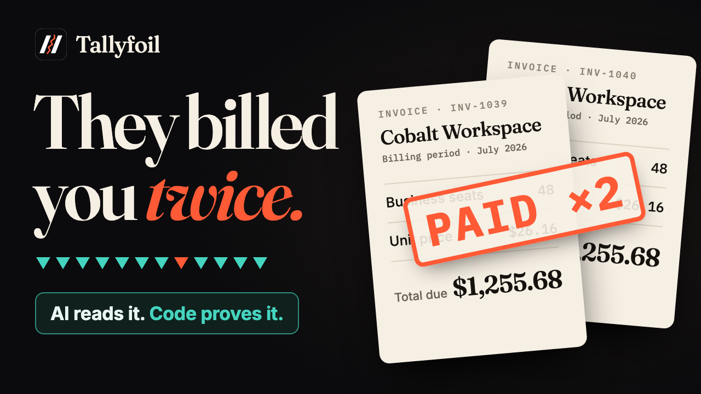
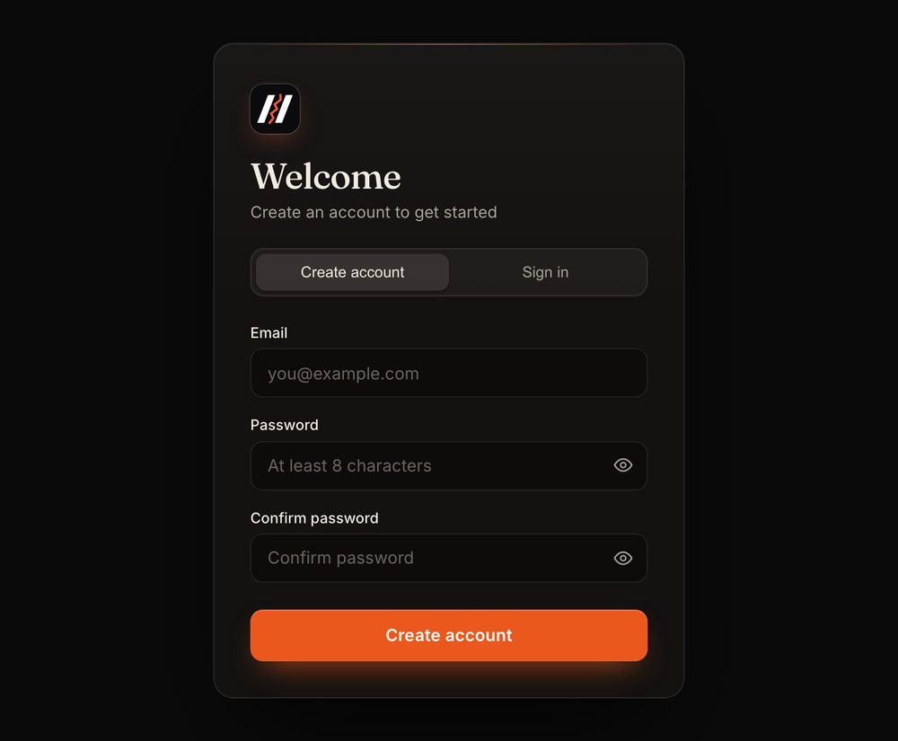
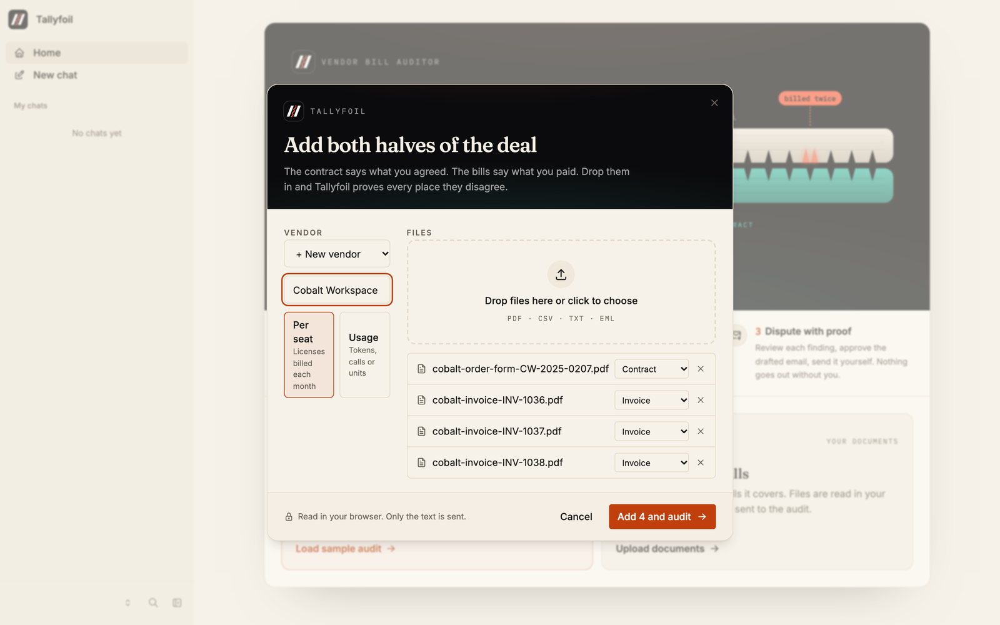
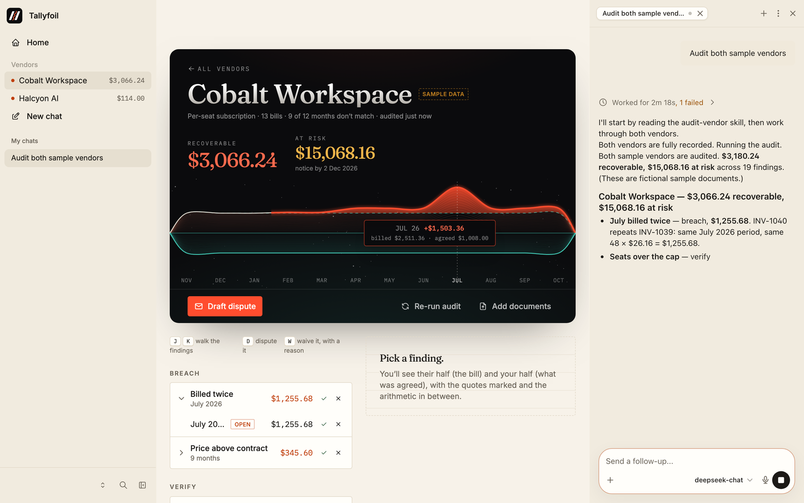
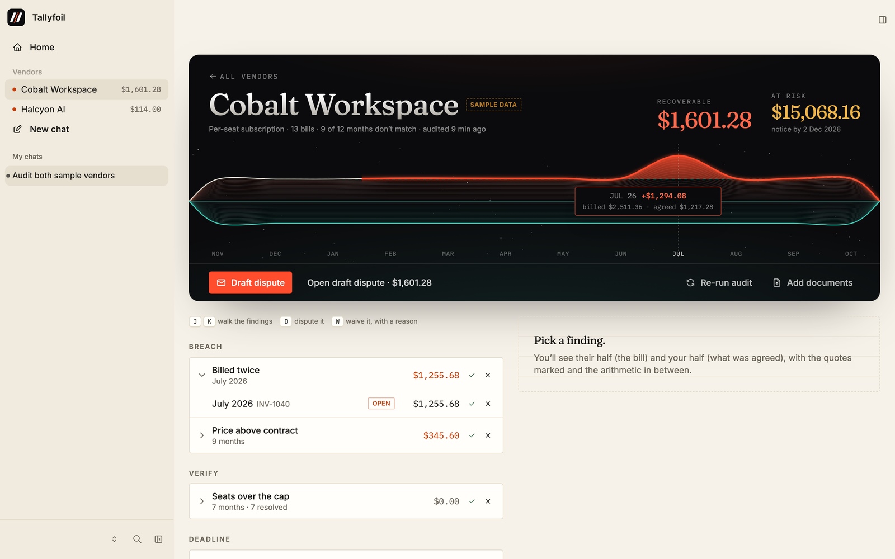

<p align="center">
  
</p>

<h1 align="center">Tallyfoil</h1>

<p align="center">
  <b>Every vendor overcharge, proven.</b><br />
  Tallyfoil audits your vendor bills against what you agreed, proves each overcharge
  with quotes from both documents, and drafts the dispute.
</p>

<p align="center">
  <a href="https://tallyfoil.vercel.app"><b>Try it live</b></a> ·
  <a href="https://youtu.be/HRD7-Imp7CQ"><b>Watch the 66-second demo</b></a> ·
  <a href="#run-it-locally"><b>Run it locally</b></a>
</p>

<p align="center">
  
  
  
  
</p>

<p align="center">
  <a href="https://youtu.be/HRD7-Imp7CQ">
    
  </a>
</p>

---

## The problem

Vendors overbill quietly. A renewal comes in 9% higher when the contract caps it at 5%.
You pay for 48 seats on a 40-seat license. July gets invoiced twice. The usage bill
counts millions more tokens than your own export logged. Nobody checks line by line,
because it is tedious, and you can't trust an AI that "reads" the invoice and makes up
a number. A dispute built on a guess gets thrown back at you.

## The idea: the AI reads, code decides the money

Tallyfoil splits the work between an agent and plain code. Each side does what it's
good at:

| | The agent (judgment) | Deterministic code (the money) |
|---|---|---|
| **Reading** | Pulls terms and bill lines out of messy PDFs, CSVs and emails | Rejects every value whose quote isn't in the source document, or whose quote doesn't contain the value |
| **Auditing** | Explains findings, answers "why?" | `server/audit/engine.ts` computes every finding in integer cents. Rates are integer micro-dollars. |
| **Learning** | Turns "we approved 48 seats by email" into a vendor rule, quoting the email as proof | Re-runs the audit with the rule applied |
| **Disputing** | Drafts the email | The **number guard** blocks approval while the prose contains any amount the engine never computed |

The agent never writes a dollar amount into the database. Click any number in the app
and you can see where it came from.

<p align="center">
  
  <br /><sub>The overview. What they billed sits above the line and what you agreed sits below it. An overcharge breaks the mirror, and you can click it to open the proof.</sub>
</p>

## How it works

<table>
  <tr>
    <td width="50%" valign="top">
      <b>1. Sign up in seconds</b><br />
      Email and password. Then load the labeled sample audit, or bring your own bills.<br /><br />
      
    </td>
    <td width="50%" valign="top">
      <b>2. Add both halves of the deal</b><br />
      Drop in the contract and the invoices, plus the usage export for AI and API vendors.
      Files are read in your browser (pdf.js, papaparse), and only the text is sent.<br /><br />
      
    </td>
  </tr>
  <tr>
    <td width="50%" valign="top">
      <b>3. The agent reads, the engine audits</b><br />
      The in-app agent records each term and bill line with its quotes. The audit engine
      then computes the findings. The agent never does the math.<br /><br />
      
    </td>
    <td width="50%" valign="top">
      <b>4. Click any number to see the proof</b><br />
      Every finding opens the bill line and the contract clause, both highlighted in the
      original document, with the arithmetic between them.<br /><br />
      
    </td>
  </tr>
  <tr>
    <td width="50%" valign="top">
      <b>5. Teach it, with proof</b><br />
      Reject a finding with a reason and paste the approval email. The agent turns it into
      a vendor rule labeled <i>Proven by email</i>, and the totals update live.<br /><br />
      
    </td>
    <td width="50%" valign="top">
      <b>6. Dispute without invented numbers</b><br />
      The agent drafts the email. Slip in "$5,000 goodwill credit" and the number guard
      catches it as you type. Approval stays blocked until every amount traces back to the ledger.<br /><br />
      
    </td>
  </tr>
</table>

**Then close the loop.** Paste the vendor's reply. The agent quotes the line that states
the credit, and code reads the amount from the vendor's own words. The dispute is marked
*Recovered* or *Part recovered*. A daily **renewal watch** automation re-runs the audit
and warns you before an auto-renewal notice window closes.

**Move fast.** <kbd>J</kbd>/<kbd>K</kbd> step through findings while the evidence follows,
<kbd>D</kbd> stamps a finding for the dispute, and <kbd>W</kbd> waives it and asks why.

## What it catches

| Check | Example from the sample audit | Severity |
|---|---|---|
| Invoice billed twice for the same period | INV-1040 repeats INV-1039: July 2026, $1,255.68 | breach |
| Unit price above the contract (renewal uplift cap) | $26.16 a seat, where the 5% cap allows $25.20 | breach |
| Usage billed above what the usage export logged | 23M input tokens more than the export recorded | breach |
| Metered rate above the contract | Billed above the agreed rate per 1M tokens | breach |
| Seats billed beyond the licensed cap | 48 seats billed on a 40-seat license | verify |
| Auto-renewal notice deadline approaching | Notice due 2 Dec 2026, with $15,068.16 at risk | deadline |

## Built on Agent-Native

Tallyfoil is an [Agent-Native](https://www.agent-native.com) app built on the Chat
template. The UI and the agent are two clients of the same actions:


| Agent-Native primitive | How Tallyfoil uses it |
|---|---|
| `defineAction` | 24 actions are the only API. The UI calls them, and the agent calls the same ones as tools. UI-only views are marked `agentTool: false`. |
| `sendToAgentChat` | The buttons that need judgment ("Ask why", "Reject and teach", "Draft dispute") hand off to the agent. There are no inline LLM calls. |
| App state and `view-screen` | `navigation` and `selection` let the agent act on "this finding" or a highlighted range of a document. |
| `needsApproval` | `approve-dispute` waits for you, and the agent never sends email. |
| Skills | `audit-vendor`, `learn-from-rejection` and `write-dispute` in `app/.agents/skills/` |
| Automations | The daily renewal watch, installed for each user at `jobs/renewal-watch.md` |
| Drizzle and Postgres | Every table has `owner_email`, and every query filters by it. PGlite runs locally and Neon in production. |

## Run it locally

```bash
cd app
pnpm install
pnpm dev                 # http://localhost:8080, then "Continue as local dev"
pnpm test                # audit engine, evidence matcher, number guard (118 tests)
```

Connect a model in the chat panel (**Use Builder.io** or **Custom keys**), or set one in
`app/.env`. You can use `ANTHROPIC_API_KEY` or any OpenAI-compatible endpoint. The live
app runs on DeepSeek with `OPENAI_API_KEY`, `OPENAI_BASE_URL`, `AGENT_ENGINE=ai-sdk:openai`
and `AGENT_MODEL=deepseek-chat` (see `app/.env.example`). Then click **Load sample audit**,
and the agent reads and audits both sample vendors.

To see the finished audit without a model, replay the sample reading:

```bash
pnpm replay-sample       # 19 findings, $3,180.24 recoverable, $15,068.16 at risk
```

## Sample data you can check by hand

The demo uses a fictional sample set with known errors. Every sample document says
"SAMPLE DOCUMENT", and sample vendors carry a *Sample data* badge in the UI.

- **Cobalt Workspace** (SaaS seats) has an order form and 13 monthly invoices. The renewal price is
  9% above a 5% cap, 48 seats are billed against a 40-seat license, July is billed twice, and
  the auto-renew notice is due 2 Dec 2026.
- **Halcyon AI** (API usage) has an order form, an invoice and a usage export. The invoice bills
  23M more input tokens than the export logged, at a rate above the contract.

| Scenario | Recoverable | At risk |
|---|---|---|
| Before any human input | **$3,180.24** | $15,068.16 |
| After the rule "we approved 48 seats from April" | **$1,769.04** | $15,068.16 |

`app/seed/expected-findings.json` holds the exact expected output, and `pnpm test`
checks that the engine reproduces it to the cent.

## Repo map

```
app/
  actions/               24 defineAction()s, shared by the UI and the agent
  server/audit/          engine, evidence matcher, number guard (pure, integer cents)
  server/tally/          persistence, views, dispute composition, renewal watch
  server/db/schema.ts    Drizzle schema, every table owner-scoped
  app/components/tally/  the UI: overview, mirror chart, evidence, dispute composer
  .agents/skills/        audit-vendor · learn-from-rejection · write-dispute
  AGENTS.md              the in-app agent's instructions
  seed/                  the labeled sample set and its expected findings
docs/
  SPEC.md                product spec, data model, every action
  ENGINE.md              audit rules and the evidence check
  FRAMEWORK_NOTES.md     the Agent-Native APIs we verified and used
  UI.md                  screens and visual design
```

## Pre-existing work

Built solo in two days during the Builder.io Agent-Native Hackathon (8–9 Nov 2026), on
the Agent-Native Chat template (`@agent-native/core` 0.226.0). Libraries: Drizzle, zod,
pdfjs-dist, papaparse, vitest and Tailwind. It uses no code from earlier projects.

<p align="center">
  Built by <b>Martin Chinedu Machiebe</b><br />
  <sub>The AI reads. Code decides the money.</sub>
</p>
